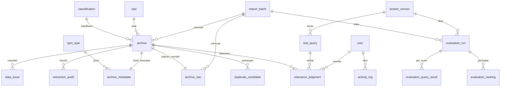
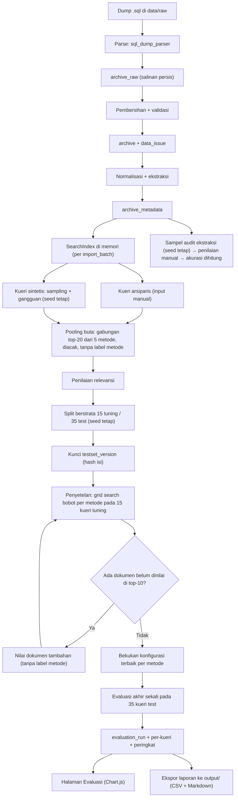

# Rancangan Aplikasi Pencarian Arsip SIMANIS

Tech stack: **Flask + SQLite (SQLAlchemy) + rapidfuzz + pandas + Bootstrap 5 + Chart.js**, dengan pengujian pytest dan dijalankan memakai waitress.

---

## 0. Temuan awal yang memengaruhi rancangan

> [!IMPORTANT]
> **File audit ekstraksi ternyata kosong.** Di [sampel_audit_100.csv](file:///D:/Coding/earsip/sampel_audit_100.csv) (100 baris), kolom `spm_benar?`, `sp2d_benar?`, `tanggal_benar?`, `jumlah_benar?`, `pihak_benar?`, dan `catatan` belum terisi satu pun. Begitu juga kolom `benar?` di [sampel_audit.csv](file:///D:/Coding/earsip/sampel_audit.csv) (40 baris). Artinya klaim **"100% (367/367)"** di prototype belum punya bukti. Audit perlu diulang lewat halaman Audit Ekstraksi, dan akurasinya dihitung oleh skrip.

- **Pembanding LIKE meniru cara SIMANIS mencari.** Daftar arsip di SIMANIS memakai pencarian DataTables di sisi klien dengan setelan bawaan ([custom.js](file:///D:/Coding/earsip/assets/js/custom.js#L2-L15)). Kueri dipecah per spasi, dan setiap kata harus muncul sebagai potongan teks (tanpa membedakan huruf besar-kecil) di kolom mana pun yang tampil. Hasil diurutkan `id_arsip ASC` ([Arsip_model.php](file:///D:/Coding/earsip/application/models/Arsip_model.php#L16)). Pembanding kita memakai aturan yang sama dengan SQL `LIKE '%kata%'` yang digabung AND. Dengan begitu, perbandingannya jujur terhadap sistem yang berjalan sekarang.
- **Kolom `jumlah` di tabel sumber bukan nominal uang.** Isinya keterangan banyaknya berkas (misalnya "1 Berkas"). Nominal Rp berasal dari ekstraksi `ringkasan`. Di skema baru keduanya dipisah: `quantity_label` dan `amount_rp`.
- **Nama modul memakai bahasa Inggris**, mengikuti aturan kode berbahasa Inggris. Modul prototype dipindahkan sambil diganti namanya, misalnya `ekstraksi.py` menjadi `core/extraction.py`.

---

## 1. Struktur folder

```
PM/
├── app/                          # Lapisan web (Flask)
│   ├── __init__.py               # create_app()
│   ├── config.py                 # Konfigurasi dari .env
│   ├── extensions.py             # db, login_manager, csrf
│   ├── security.py               # Dekorator role_required('admin')
│   ├── cli.py                    # Perintah `flask ...` (impor, set uji, evaluasi, laporan)
│   ├── models/                   # Model SQLAlchemy
│   │   ├── user.py               # User, ActivityLog
│   │   ├── archive.py            # ImportBatch, Opd, Classification, ArchiveRaw, Archive, ArchiveMetadata, DataIssue
│   │   ├── reference.py          # SpmType, AppSetting
│   │   ├── audit.py              # ExtractionAudit
│   │   ├── testset.py            # TestsetVersion, TestQuery, RelevanceJudgment
│   │   ├── evaluation.py         # EvaluationRun, EvaluationQueryResult, EvaluationRanking
│   │   └── duplicate.py          # DuplicateCandidate (fase 2)
│   ├── services/                 # Penghubung core ↔ database (dipakai oleh UI dan CLI)
│   │   ├── import_service.py
│   │   ├── search_service.py     # Cache indeks per import_batch
│   │   ├── audit_service.py
│   │   ├── testset_service.py
│   │   ├── evaluation_service.py
│   │   ├── stats_service.py      # SATU-SATUNYA sumber angka untuk dashboard
│   │   └── report_service.py     # Ekspor tabel laporan ke output/
│   ├── blueprints/
│   │   ├── auth/  main/  search/  archives/  admin/  testset/  evaluation/
│   │   └── quality/  duplicates/ # fase 2
│   ├── templates/                # base.html, partials/, satu folder per blueprint
│   └── static/
│       ├── css/app.css           # Design token (warna, spacing 4/8px, radius, shadow)
│       ├── js/
│       └── vendor/               # Bootstrap 5, Chart.js, font Inter (lokal, tanpa CDN)
├── core/                         # Python murni, tanpa Flask, mudah diuji pytest
│   ├── sql_dump_parser.py        # ← prototype data_loader.py
│   ├── cleaning.py               # Validasi tanggal/tahun/status → daftar masalah data
│   ├── normalization.py          # Normalisasi teks & kode nomor
│   ├── extraction.py             # ← prototype ekstraksi.py
│   ├── spm_types.py              # Kamus awal jenis SPM (status: dugaan)
│   ├── search/
│   │   ├── index.py              # SearchIndex: dokumen, token, kosakata
│   │   ├── matchers/             # base.py, levenshtein.py, jaro_winkler.py, token_set.py, ngram.py
│   │   ├── like_baseline.py      # Meniru pencarian DataTables SIMANIS
│   │   └── ranker.py             # Skor gabungan per field berbobot
│   ├── testset/                  # noise.py, sampling.py, pooling.py, splitting.py
│   └── evaluation/               # metrics.py, tuning.py, significance.py
├── tests/                        # Struktur mengikuti core/ (test_extraction.py, test_metrics.py, ...)
├── data/
│   ├── raw/                      # [diabaikan Git] dump .sql
│   └── testset/                  # testset_vN.json, dilacak Git (lihat Keputusan #1)
├── instance/                     # [diabaikan Git] app.sqlite
├── output/                       # [diabaikan Git] CSV/Markdown hasil evaluasi & laporan
├── docs/                         # ERD, use case, flowchart (draw.io)
├── wsgi.py                       # Entry point waitress
├── requirements.txt
├── .env.example
└── README.md
```

**Prinsip:** `core/` tidak tahu soal Flask maupun database. Halaman web dan perintah CLI sama-sama memanggil `services/`, jadi angka di aplikasi dan angka di laporan berasal dari kode yang sama.

---

## 2. Skema SQLite



### 2.1 Data arsip

| Tabel | Kolom utama | Catatan |
|---|---|---|
| `import_batch` | `id`, `source_filename`, `source_sha256`, `parser_version`, `extractor_version`, `raw_count`, `clean_count`, `issue_count`, `status`, `error_message`, `imported_by`, `imported_at` | Jejak setiap impor. Hash dump disimpan supaya hasil evaluasi bisa dilacak ke data yang dipakai |
| `opd` | `id` (= `id_opd`), `name`, `name_normalized` | Dari `apptb_opd` |
| `classification` | `id` (= `id_klasifikasi`), `code`, `name` | Dari `apptb_klasifikasi` (`index` → `name`) |
| `archive_raw` | `id_arsip` PK, `batch_id`, 20 kolom asli disimpan sebagai TEXT apa adanya | Salinan persis untuk audit, tidak pernah diubah |
| `archive` | `id` (= `id_arsip`), `batch_id`, `opd_id` (NULL jika OPD-nya sudah dihapus), `opd_id_source`, `classification_id`, `year` INT NULL, `input_date` DATE NULL, `file_number`, `index_label`, `summary_raw`, `summary_clean`, `summary_normalized`, `location_block/rack/row`, `box_number`, `development_level`, `quantity_label`, `file_note`, `retention_note`, `status` CHECK IN (1,2,3), `document_filename` NULL, `has_document` | Data yang sudah dibersihkan. `0000-00-00` → NULL dan dicatat sebagai masalah data |
| `archive_metadata` | `archive_id` PK, `spm_number`, `spm_sequence`, `spm_type_code`, `spm_suffix`, `sp2d_number`, `document_date`, `amount_rp` INT, `party_name`, `party_normalized`, `has_spm_label`, `extractor_version`, `extracted_at` | Hasil `core/extraction.py` |
| `spm_type` | `code` PK, `label`, `confidence` CHECK IN ('dugaan','terkonfirmasi'), `source_note`, `confirmed_by`, `confirmed_at` | Diisi awal dengan 7 kode dari prototype, **semuanya `dugaan`**. Di UI tampil dengan badge "dugaan" |
| `data_issue` | `id`, `archive_id`, `batch_id`, `issue_type`, `field_name`, `raw_value`, `detail` | Jenis masalah: `invalid_input_date`, `invalid_year`, `orphan_opd`, `orphan_classification`, `empty_summary`, `missing_document`, `invalid_status`. Dipakai halaman Kualitas Data (fase 2) |

### 2.2 Audit, pengguna, pengaturan

| Tabel | Kolom utama | Catatan |
|---|---|---|
| `extraction_audit` | `id`, `archive_id`, `field` CHECK IN (spm, sp2d, document_date, amount_rp, party), `extracted_value`, `expected_value`, `verdict` CHECK IN ('benar','salah') NULL, `sample_seed`, `extractor_version`, `auditor_id`, `audited_at` | Akurasi = jumlah `benar` dibagi jumlah yang sudah dinilai, dihitung skrip per field |
| `user` | `id`, `username` UNIQUE, `full_name`, `password_hash`, `role` CHECK IN ('admin','petugas'), `is_active`, `created_at`, `last_login_at` | Hash memakai `werkzeug.security` (scrypt) |
| `activity_log` | `id`, `user_id`, `action`, `target_type`, `target_id`, `detail`, `ip`, `created_at` | Mencatat login, impor, perubahan set uji, penilaian, evaluasi, penandaan duplikat |
| `app_setting` | `key` PK, `value` | Contoh: `default_search_method`, diisi admin setelah evaluasi akhir |

### 2.3 Set uji dan evaluasi

| Tabel | Kolom utama | Catatan |
|---|---|---|
| `testset_version` | `id`, `label`, `split_seed`, `content_sha256`, `locked_at`, `locked_by` | Setelah dikunci, kueri, split, dan penilaian tidak bisa diubah |
| `test_query` | `id`, `version_id`, `code` (Q001…), `query_text`, `query_type` CHECK IN ('topik','nomor_spm','pihak','campuran'), `source` CHECK IN ('arsiparis','sintetis'), `noise_type` NULL, `origin_archive_id` NULL, `split` CHECK IN ('tuning','test'), `note`, `created_by` | `noise_type`: `typo`, `singkatan`, `spasi_tanda_baca`, `urutan_kata`, `kata_hilang`, `ejaan_varian`, `tanpa_gangguan` |
| `relevance_judgment` | PK (`query_id`, `archive_id`), `is_relevant`, `judged_by`, `judged_at` | Dokumen yang tidak dinilai dianggap tidak relevan (asumsi standar pooling) |
| `evaluation_run` | `id`, `purpose` CHECK IN ('tuning','final'), `split`, `method` CHECK IN ('like','levenshtein','jaro_winkler','token_set','ngram'), `config_json`, `config_sha`, `testset_version_id`, `import_batch_id`, `dataset_sha256`, `code_commit`, `n_queries`, `p_at_5`, `r_at_10`, `mrr_at_10`, `mean_latency_ms`, `is_selected`, `created_by`, `started_at`, `finished_at` | Setiap angka di laporan mengacu ke `evaluation_run.id` |
| `evaluation_query_result` | PK (`run_id`, `query_id`), `n_relevant`, `p_at_5`, `r_at_10`, `reciprocal_rank`, `first_relevant_rank`, `unjudged_in_top10`, `latency_ms` | Data per kueri untuk rincian dan uji signifikansi |
| `evaluation_ranking` | PK (`run_id`, `query_id`, `rank`), `archive_id`, `score`, `is_relevant` | 10 hasil teratas per kueri, sebagai bukti yang bisa diperiksa ulang |

### 2.4 Fase 2

| Tabel | Kolom utama |
|---|---|
| `duplicate_candidate` | `id`, `archive_a_id`, `archive_b_id` (CHECK a < b, UNIQUE), `text_similarity`, `metadata_similarity`, `combined_score`, `detector_version`, `batch_id`, `status` CHECK IN ('belum_dicek','duplikat','bukan_duplikat') DEFAULT 'belum_dicek', `reviewed_by`, `reviewed_at`, `note` |

Tidak ada operasi hapus arsip di mana pun. Halaman duplikat hanya mengubah `status`.

---

## 3. Alur dari impor sampai evaluasi



### 3.1 Impor
- Seluruh proses berjalan dalam satu transaksi. Jika gagal, data lama tetap utuh dan `import_batch.status = 'failed'`.
- Impor ulang mengganti seluruh data arsip. `relevance_judgment` mengacu ke `id_arsip` asli, jadi tetap berlaku. Sistem melaporkan penilaian yang menunjuk ke ID yang sudah tidak ada.
- Laporan impor menampilkan angka hasil hitung: jumlah mentah, bersih, dan masalah per jenis; cakupan ekstraksi per field; serta daftar kode SPM yang ditemukan beserta frekuensinya. Daftar kode ini membantu menentukan kode mana yang perlu dikonfirmasi ke dinas.

### 3.2 Normalisasi (`core/normalization.py`)
Dipakai sama persis oleh keempat metode *fuzzy*, untuk dokumen maupun kueri. Dengan begitu, perbedaan hasil antarmetode hanya berasal dari fungsi kemiripannya.
1. Unicode NFKC, huruf kecil, rapikan spasi.
2. **Kode nomor dipertahankan sebagai satu token.** `446 / bt/5/p` menjadi `446/BT/5/P`, supaya garis miring tidak memecahnya.
3. Tanda baca lain diganti spasi.
4. Kamus singkatan yang terbatas dan terdokumentasi: `kec`→kecamatan, `kel`→kelurahan, `jl/jln`→jalan, `lrg`→lorong, `pemb`→pembangunan, dan variasi bulan (`nopember`, `pebruari`).

Pembanding LIKE **tidak** memakai normalisasi ini, karena ia meniru SIMANIS apa adanya.

### 3.3 Pencocokan multi-metode (`core/search/`)

Setiap arsip punya tiga field yang dicari: **ringkasan**, **nomor SPM**, dan **pihak (CV/PT)**.

| Metode | Skor per field | Sumber |
|---|---|---|
| LIKE (pembanding) | Lolos jika setiap kata kueri muncul (`LIKE '%kata%'`, digabung AND) di gabungan kolom tampilan SIMANIS. Urutan `id_arsip ASC`, tanpa skor | SQL SQLite |
| Levenshtein | Untuk tiap token kueri, ambil kemiripan tertinggi terhadap token field, lalu dirata-rata | `rapidfuzz.distance.Levenshtein.normalized_similarity` |
| Jaro-Winkler | Sama seperti di atas | `rapidfuzz.distance.JaroWinkler.normalized_similarity` |
| Token set | `token_set_ratio(kueri, field) / 100` untuk seluruh string | `rapidfuzz.fuzz.token_set_ratio` |
| N-gram | Koefisien Dice n-gram karakter (dengan padding), cara agregasi per token sama dengan Levenshtein | **Ditulis sendiri** dan diuji pytest |

> [!NOTE]
> rapidfuzz **tidak** menyediakan metrik n-gram. Fungsi Dice n-gram ditulis sendiri (pendek dan teruji). Hal ini perlu disebutkan di Bab III.

- **Skor akhir** = `w_ringkasan·s(ringkasan) + w_spm·s(spm) + w_pihak·s(pihak)`, dengan total bobot = 1.
- **Penyetelan** dilakukan dengan grid search bobot berlangkah 0,1 (66 kombinasi), ditambah `n ∈ {2, 3}` khusus n-gram. Penyetelan hanya memakai 15 kueri tuning dan berjalan terpisah untuk tiap metode. Tujuan utamanya MRR@10; jika seri, dipilih P@5 yang lebih tinggi.
- **Evaluasi tidak memakai ambang skor**, cukup peringkat top-10. Ambang hanya untuk menyembunyikan hasil yang sangat rendah di UI, sehingga tidak ada parameter tambahan yang perlu disetel.
- **Performa:** kemiripan token kueri dihitung terhadap seluruh kosakata sekaligus memakai `rapidfuzz.process.cdist`. Hasilnya lalu dicari per dokumen. Untuk sekitar 1.737 dokumen, ini jauh di bawah 1 detik.

### 3.4 Protokol set uji
- **Komposisi:** 50 kueri, yaitu kasus nyata dari arsiparis ditambah kueri sintetis. Satu kueri sintetis diberi satu jenis gangguan yang tercatat di `noise_type`.
- **Pooling buta:** untuk setiap kueri, top-20 dari kelima metode (dengan bobot awal yang sama) digabung, diacak dengan seed, dan ditampilkan tanpa nama metode. Arsip asal kueri sintetis dipastikan masuk ke kumpulan ini.
- **Validasi sebelum dikunci:** setiap kueri wajib punya minimal 1 dokumen relevan, karena R@10 tidak terdefinisi jika tidak ada.
- **Split berstrata** menurut `source × query_type` dengan seed tetap, sehingga kedua sumber kueri ada di kedua kelompok.
- **Setelah set uji dikunci**, penyetelan hanya membaca kelompok `tuning`. Evaluasi akhir membaca kelompok `test` dengan konfigurasi yang sudah dibekukan. Setiap pengulangan evaluasi akhir tetap tercatat di log.
- **Jaga cakupan penilaian:** `unjudged_in_top10` dihitung per kueri. Jika setelah penyetelan ada dokumen baru di top-10 yang belum dinilai, dokumen itu dinilai dulu (tetap tanpa label metode) sebelum evaluasi akhir.

### 3.5 Definisi metrik (`core/evaluation/metrics.py`)
- **P@5** = jumlah dokumen relevan di 5 teratas ÷ 5.
- **R@10** = jumlah dokumen relevan di 10 teratas ÷ jumlah seluruh dokumen relevan.
- **RR** = 1 ÷ peringkat dokumen relevan pertama di 10 teratas; bernilai 0 jika tidak ada. **MRR@10** = rata-rata RR.
- Semua metrik dirata-rata per kueri (*macro*). Setiap fungsi punya uji pytest dengan contoh yang dihitung tangan.

> [!WARNING]
> Untuk kueri nomor SPM, biasanya hanya ada 1 dokumen relevan, sehingga **P@5 maksimal 0,2**. Ini perilaku standar metrik tersebut, bukan kesalahan. Laporan menampilkan metrik per `query_type` dan menjadikan MRR sebagai metrik utama untuk kueri yang mencari satu dokumen tertentu.

- **Disarankan:** uji Wilcoxon *signed-rank* berpasangan atas RR per kueri, antara metode terbaik dan LIKE serta antara dua metode teratas (`scipy`). Dengan 35 kueri, uji ini membuat klaim "lebih baik" bisa dipertanggungjawabkan.

### 3.6 Aturan "tidak ada angka diketik manual"
- Template tidak boleh berisi angka metrik. Semua angka diambil dari `stats_service` atau tabel `evaluation_*`.
- Ekspor laporan menghasilkan tabel Markdown dan CSV di `output/reports/`. Setiap tabel diberi keterangan `run_id`, waktu, `code_commit`, `dataset_sha256`, dan `testset content_sha256`.
- Docstring dan teks UI tidak boleh berisi klaim akurasi. Klaim "100%" dari prototype dihapus.
- Kamus SPM yang masih `dugaan` selalu tampil dengan badge **dugaan** di hasil pencarian, detail arsip, dan laporan.

---

## 4. Daftar halaman

| # | Halaman | Route | Peran | Fase | Isi |
|---|---|---|---|---|---|
| 1 | Login | `/login` | publik | 1 | Form + CSRF. Pesan galat umum (tidak membocorkan apakah username ada) |
| 2 | Dashboard | `/` | admin, petugas | 1 | Total arsip, impor terakhir, cakupan ekstraksi per field, ringkasan evaluasi akhir terakhir. Semua angka dihitung |
| 3 | Pencarian | `/search` | admin, petugas | 1 | Satu kotak cari, filter OPD/tahun/status, pemilih metode (bawaan dari `app_setting`), hasil berisi skor, bagian yang cocok disorot, SPM, tanggal, nominal, pihak, dan badge jenis SPM "dugaan" |
| 4 | Perbandingan metode | `/search/compare` | admin | 1 | Top-10 kelima metode berdampingan untuk satu kueri, untuk analisis Bab IV |
| 5 | Detail arsip | `/archives/<id>` | admin, petugas | 1 | Ringkasan mentah vs hasil ekstraksi, lokasi fisik, status, ketersediaan berkas, masalah data. Di fase 2 ditambah status duplikat |
| 6 | Impor data | `/admin/import` | admin | 1 | Pilih dump dari `data/raw/`, jalankan impor, riwayat `import_batch` beserta jumlah record dan masalah |
| 7 | Ekstraksi & kamus SPM | `/admin/extraction` | admin | 1 | Cakupan per field, daftar arsip yang gagal diekstrak, frekuensi kode SPM, ubah status kamus menjadi `terkonfirmasi` |
| 8 | Audit ekstraksi | `/admin/extraction/audit` | admin, petugas | 1 | Buat sampel (ukuran + seed), nilai benar/salah per field, akurasi per field dihitung |
| 9 | Set uji | `/testset` | admin | 1 | Daftar kueri, tambah kueri arsiparis, buat kueri sintetis, split, validasi, kunci versi, ekspor JSON |
| 10 | Penilaian relevansi | `/testset/judge/<query>` | admin, petugas | 1 | Kumpulan hasil diacak tanpa nama metode, tandai relevan/tidak, progres penilaian |
| 11 | Evaluasi | `/evaluation` | admin | 1 | Jalankan penyetelan dan evaluasi akhir, tabel run, grafik batang P@5/R@10/MRR per metode, rincian per `query_type` dan `noise_type`, uji signifikansi, ekspor |
| 12 | Rincian run | `/evaluation/runs/<id>` | admin | 1 | Metrik per kueri dan top-10 dengan tanda relevan, untuk bukti |
| 13 | Pengguna | `/admin/users` | admin | 1 | Tambah, nonaktifkan, dan reset kata sandi pengguna. Admin tidak bisa menonaktifkan dirinya sendiri |
| 14 | Log aktivitas | `/admin/activity` | admin | 1 | Filter per pengguna atau aksi |
| 15 | Kualitas data | `/quality` | admin, petugas | 2 | Grafik Chart.js dari `data_issue` dan cakupan metadata per OPD/tahun |
| 16 | Penanda duplikat | `/duplicates` | admin, petugas | 2 | Antrean pasangan kandidat dibandingkan berdampingan, tandai `duplikat` / `bukan_duplikat`, **tanpa tombol hapus** |

Halaman galat: 403, 404, dan 500 dengan pesan ramah. Detail galat hanya masuk ke log.

---

## 5. Perintah CLI (`flask ...`)

| Perintah | Fungsi |
|---|---|
| `init-db` | Membuat tabel dan mengisi `spm_type` (semua berstatus dugaan) |
| `create-user --role admin` | Membuat akun pertama (kata sandi diminta secara interaktif) |
| `import-dump data/raw/<file>.sql` | Menjalankan parse, pembersihan, dan ekstraksi, lalu menyimpan `import_batch` |
| `audit sample --size 100 --seed 42` | Membuat sampel audit ekstraksi |
| `testset synth --n <jumlah> --seed 42` | Membuat kueri sintetis |
| `testset pool --depth 20 --seed 42` | Menyusun kumpulan hasil untuk dinilai |
| `testset split --tuning 15 --seed 42` / `testset lock` / `testset export` | Membagi, mengunci, dan mengekspor set uji |
| `evaluate tune` / `evaluate final` | Penyetelan pada kelompok tuning, evaluasi akhir pada kelompok test |
| `report export` | Menulis tabel laporan ke `output/reports/` |

---

## 6. Dependensi

`flask`, `flask-sqlalchemy`, `flask-login`, `flask-wtf`, `rapidfuzz`, `pandas`, `waitress`, `python-dotenv`, `pytest`, dan opsional `scipy` untuk uji Wilcoxon. Python 3.14 (sama dengan venv prototype). Versi dikunci di `requirements.txt`.

---

## 7. Keputusan yang perlu dikonfirmasi

1. **Set uji dilacak di Git sebagai JSON** (`data/testset/testset_vN.json`). Semua CSV diabaikan sesuai permintaan, tetapi set uji dan penilaiannya adalah bahan penelitian yang harus bisa diulang. Kalau hanya ada di SQLite (yang diabaikan Git), set uji bisa hilang. Isinya cuma teks kueri dan ID arsip, tanpa isi arsip.
2. **Siapa yang menilai relevansi:** kueri arsiparis dinilai arsiparis (dengan akun `petugas`), kueri sintetis dinilai kamu? Opsional: dinilai dua orang untuk sebagian kueri, lalu dihitung Cohen's kappa.
3. **Kedalaman pool 20** (lebih dalam dari k=10) supaya jumlah dokumen yang perlu dinilai tambahan setelah penyetelan tetap sedikit.
4. **Aset tampilan disimpan lokal** (Bootstrap, Chart.js, font Inter di `static/vendor/`), supaya tetap berjalan di jaringan dinas tanpa internet.
